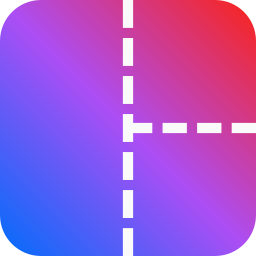

<h1 align="center">
  
  Seelen UI Library
</h1>

The **Seelen UI Library** is the core library for [Seelen UI](https://github.com/eythaann/seelen-ui), a highly
customizable desktop UI. This library provides the necessary tools and types to create and manage widgets, plugins, and
themes for the Seelen UI application. It's a hybrid library with a Rust core and TypeScript/Deno bindings, designed for
performance and type safety.

## Installation

### TypeScript/Deno

You can use the library from JSR or npm.

**JSR:**

```sh
deno add @seelen-ui/lib
```

**NPM:**

```sh
npm install @seelen-ui/lib
```

## Contributing

Contributions are welcome! Please read our [contributing guidelines](contributing.md) to get started.

## License

This project is licensed under the AGPL-3.0 License. See the [LICENSE](LICENSE) file for details.

## Links

- [GitHub Repository](https://github.com/Seelen-Inc/slu-lib)
- [NPM Package](https://npmjs.com/package/@seelen-ui/lib)
- [JSR Package](https://jsr.io/@seelen-ui/lib)
